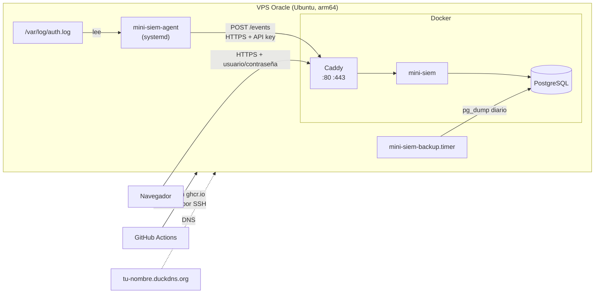

# Guía de despliegue: de cero a una URL pública, gratis

> **Nota:** el proyecto no está desplegado actualmente. Esta guía documenta el camino previsto y los archivos de esta carpeta están listos, pero no logré completar el alta en un VPS gratuito. Para ver el SIEM funcionando en local, consulta el [Inicio rápido](../README.md#inicio-rápido).

Esta guía parte de que **no tienes ninguna cuenta**. Al final tendrás el SIEM en línea con HTTPS, el agente vigilando el SSH del servidor y cada `git push` a `main` desplegándose solo.

**Lo que usarás (todo gratis):** [Oracle Cloud Always Free](https://www.oracle.com/cloud/free/) para el servidor, [DuckDNS](https://www.duckdns.org) para el subdominio y GitHub para el despliegue automático. Los comandos de tu máquina son para **PowerShell** (Windows); los del servidor, para Linux.

**Tiempo estimado:** 1 a 2 horas, la mayoría esperando registros y verificaciones.



## Índice

1. [Cuentas](#1-cuentas)
2. [Crear el servidor en Oracle](#2-crear-el-servidor-en-oracle)
3. [Abrir los puertos en Oracle](#3-abrir-los-puertos-en-oracle)
4. [Conectarte por SSH](#4-conectarte-por-ssh)
5. [Subdominio con DuckDNS](#5-subdominio-con-duckdns)
6. [Preparar el servidor](#6-preparar-el-servidor)
7. [Configurar los secretos](#7-configurar-los-secretos)
8. [Conectar GitHub Actions](#8-conectar-github-actions)
9. [Primer despliegue y agente](#9-primer-despliegue-y-agente)
10. [Probar y hacer la demo](#10-probar-y-hacer-la-demo)
11. [Operación](#operación) · [Problemas frecuentes](#problemas-frecuentes) · [Decisiones y límites](#decisiones-y-límites)

---

## 1. Cuentas

Necesitas tres. Créalas en este orden:

**GitHub** (si aún no tienes cuenta; si ya tienes, sáltalo). Ya tienes el repo `williamfloress/mini-siem`; asegúrate de haber hecho `git push` con los commits de la fase 7.

**DuckDNS.** Entra en [duckdns.org](https://www.duckdns.org) e inicia sesión con tu cuenta de GitHub o Google. No hay formulario de registro.

**Oracle Cloud.** Es la más delicada, así que con calma:

1. Ve a [oracle.com/cloud/free](https://www.oracle.com/cloud/free/) y pulsa *Start for free*.
2. Rellena tus datos reales. Oracle **verifica la identidad**: el nombre debe coincidir con el de la tarjeta.
3. **Región de origen (*Home Region*): elígela con cuidado, no se puede cambiar después.** Los recursos gratuitos solo se crean en ella, y la capacidad de las máquinas Arm varía mucho entre regiones. Elige una cercana con buena disponibilidad (por ejemplo `US East (Ashburn)` o `Brazil East (São Paulo)`; busca la de tu zona). Si falla al crear la máquina (ver [Problemas frecuentes](#problemas-frecuentes)), la única salida es esperar o reintentar, no cambiar de región.
4. Pide una tarjeta de crédito o débito para verificar identidad. Oracle hace un cargo temporal de prueba y lo devuelve. **No cobra por recursos Always Free.** Algunas tarjetas prepagadas o virtuales son rechazadas.
5. Confirma el correo y espera a que la cuenta se active (puede tardar de minutos a unas horas). Te llegará un email de bienvenida.

> **Consejo opcional:** Oracle ofrece pasar a *Pay As You Go*. Los recursos Always Free **siguen siendo gratis** (no se cobra mientras te mantengas en sus límites), pero la cuenta deja de ser "de prueba" y tiene menos riesgo de que reclamen instancias inactivas y más probabilidad de conseguir capacidad Arm. Es decisión tuya; la guía funciona igual sin hacerlo.

## 2. Crear el servidor en Oracle

1. Entra en la consola de Oracle Cloud. Menú ☰ → **Compute** → **Instances** → **Create instance**.
2. **Name:** `mini-siem`.
3. **Image and shape** → *Edit*:
   - **Image:** *Change image* → **Canonical Ubuntu 24.04** (o 22.04).
   - **Shape:** *Change shape* → pestaña **Ampere** → **VM.Standard.A1.Flex**. Pon **2 OCPU y 12 GB de memoria** (el SIEM necesita muy poco; el límite gratuito total es 4 OCPU y 24 GB).
4. **Networking:** deja la red por defecto (crea una VCN nueva) y **asegúrate de que *Assign a public IPv4 address* esté activado**.
5. **Add SSH keys:** elige **Generate a key pair for me** y pulsa **Save private key** (y también *Save public key*). Guarda el archivo `.key` privado en una carpeta que recuerdes, por ejemplo `C:\Users\TU_USUARIO\.ssh\oracle.key`. **Si lo pierdes, no hay forma de recuperarlo.**
6. **Boot volume:** el valor por defecto (47 GB) está bien; el gratuito permite hasta 200 GB en total.
7. Pulsa **Create**. En 1-2 minutos el estado pasa de *Provisioning* a **Running**.
8. En la página de la instancia, anota la **Public IP address**. Es la IP del servidor (por ejemplo `129.151.x.x`).

Si sale el error **"Out of capacity for shape VM.Standard.A1.Flex"**, mira [Problemas frecuentes](#problemas-frecuentes).

**IP fija (recomendado).** La IP asignada se conserva mientras la instancia exista, pero si la borras y creas otra, cambia. Para evitar sorpresas: en la instancia → **Networking** → *Attached VNICs* → tu VNIC → **IPv4 Addresses** → ⋮ → *Edit* → *Reserved public IP*. Las IP reservadas **en uso** son gratuitas.

## 3. Abrir los puertos en Oracle

Oracle tiene su propio cortafuegos, **independiente del servidor**: por defecto solo deja entrar el puerto 22 (SSH). Hay que abrir el 80 (el desafío de certificados) y el 443 (HTTPS).

1. En la página de la instancia, pulsa el enlace de **Subnet** (por ejemplo `subnet-2026...`).
2. Abre la **Security List** por defecto (`Default Security List for vcn-...`).
3. **Add Ingress Rules** y crea tres reglas con **Source CIDR** `0.0.0.0/0`:

| IP Protocol | Destination Port | Descripción |
|---|---|---|
| TCP | `80` | HTTP (certificados) |
| TCP | `443` | HTTPS |
| UDP | `443` | HTTP/3 |

Deja **Source Port Range** vacío. La regla del puerto 22 ya existe.

## 4. Conectarte por SSH

En PowerShell:

```powershell
# Una sola vez: dejar la clave legible solo para ti (SSH la rechaza si otros usuarios pueden leerla)
icacls "$env:USERPROFILE\.ssh\oracle.key" /inheritance:r /grant:r "$($env:USERNAME):(R)"

ssh -i "$env:USERPROFILE\.ssh\oracle.key" ubuntu@IP_DEL_SERVIDOR
```

Escribe `yes` cuando pregunte por la huella. El usuario por defecto en Ubuntu es `ubuntu` (no `root`) y ya tiene `sudo`. Si ves el prompt `ubuntu@mini-siem:~$`, estás dentro.

> Oracle ya desactiva el acceso por contraseña: solo se entra con la clave. No hace falta endurecer SSH.

## 5. Subdominio con DuckDNS

1. En [duckdns.org](https://www.duckdns.org), en el cuadro **sub domain**, escribe un nombre (por ejemplo `miniwilliam`) → **add domain**.
2. En el campo **current ip** de ese dominio, pega la **IP pública del servidor** → **update ip**.
3. Anota tu dominio completo: `miniwilliam.duckdns.org`.

Compruébalo desde PowerShell (debe devolver la IP del servidor):

```powershell
nslookup miniwilliam.duckdns.org
```

> **Si ya tienes un dominio propio**, crea un registro `A` `siem` → IP del servidor y usa `siem.tudominio.com` en el resto de la guía.

## 6. Preparar el servidor

Desde PowerShell, **en tu máquina, dentro de la carpeta del repo**, copia la carpeta `deploy` al servidor y ejecuta el script:

```powershell
$KEY = "$env:USERPROFILE\.ssh\oracle.key"
scp -i $KEY -r deploy ubuntu@IP_DEL_SERVIDOR:~/mini-siem-deploy
ssh -i $KEY ubuntu@IP_DEL_SERVIDOR "sudo bash ~/mini-siem-deploy/setup-vps.sh"
```

El script (tarda unos minutos): instala Docker, `ufw` y `rsyslog` (Ubuntu en Oracle no siempre crea `auth.log` sin él), crea el usuario `deploy`, deja los archivos en `/opt/mini-siem`, instala las unidades de systemd, activa las copias diarias y abre solo los puertos 22, 80 y 443. Se puede repetir sin pisar la configuración.

> **Nota sobre el firewall de Ubuntu en Oracle.** Las imágenes de Ubuntu en Oracle traen reglas de `iptables` que bloquean casi todo. No te afectan: Docker publica los puertos 80 y 443 por su cuenta, saltándose esas reglas, y el 22 ya está permitido. Los dos firewalls (el de Oracle del paso 3 y este) conviven sin problema.

## 7. Configurar los secretos

Conéctate otra vez al servidor (paso 4) y genera los valores:

```bash
openssl rand -hex 24   # -> POSTGRES_PASSWORD
openssl rand -hex 32   # -> INGEST_API_KEY (va en los dos archivos)
sudo docker run --rm caddy:2-alpine caddy hash-password --plaintext 'una-contraseña-larga-para-el-panel'
```

Copia cada resultado en un bloc de notas. El último es el hash de la contraseña con la que entrarás al panel.

Edita los dos archivos (con `nano`: guarda con `Ctrl+O`, `Enter`, sal con `Ctrl+X`):

```bash
sudo nano /opt/mini-siem/.env
sudo nano /etc/mini-siem/agent.env
```

En `/opt/mini-siem/.env`:

| Variable | Valor |
|---|---|
| `SIEM_DOMAIN` | `miniwilliam.duckdns.org` |
| `POSTGRES_PASSWORD` | el primero que generaste |
| `INGEST_API_KEY` | el segundo |
| `PANEL_USER` | el usuario que quieras (por defecto `admin`) |
| `PANEL_PASSWORD_HASH` | el hash, **entre comillas simples**: `'$2a$14$...'` |
| `TELEGRAM_*` | opcional (ver el [README principal](../README.md#notificaciones-por-telegram)) |

En `/etc/mini-siem/agent.env`: `SIEM_URL=https://miniwilliam.duckdns.org` y la misma `INGEST_API_KEY`.

`POSTGRES_PASSWORD` solo se aplica la primera vez que arranca Postgres. Si la cambias después, la base no se entera.

## 8. Conectar GitHub Actions

GitHub necesita una clave SSH propia para entrar al servidor como `deploy`. Se genera **en el servidor** (más fácil que en Windows):

```bash
ssh-keygen -t ed25519 -f /tmp/deploy_key -N "" -C github-deploy
sudo sh -c 'cat /tmp/deploy_key.pub >> /home/deploy/.ssh/authorized_keys'
cat /tmp/deploy_key                              # la privada: cópiala entera, con las líneas BEGIN/END
ssh-keyscan -t ed25519 miniwilliam.duckdns.org   # la huella del servidor: cópiala
rm /tmp/deploy_key /tmp/deploy_key.pub           # ya no hacen falta en el servidor
```

En GitHub, en tu repo → **Settings → Secrets and variables → Actions**:

| Pestaña | Nombre | Valor |
|---|---|---|
| *Variables* | `DEPLOY_HOST` | `miniwilliam.duckdns.org` |
| *Variables* | `SIEM_DOMAIN` | `miniwilliam.duckdns.org` |
| *Secrets* | `DEPLOY_SSH_KEY` | la clave privada completa |
| *Secrets* | `DEPLOY_KNOWN_HOSTS` | la salida de `ssh-keyscan` (la línea que empieza por el dominio) |

Además, en **Settings → Actions → General → Workflow permissions**, deja *Read and write permissions* para que el workflow pueda publicar la imagen en `ghcr.io`.

Opcional: en **Settings → Environments → production** puedes añadir ti mismo como revisor para aprobar cada despliegue a mano.

## 9. Primer despliegue y agente

1. En GitHub: **Actions → Deploy → Run workflow** (rama `main`). La primera vez tarda unos minutos: construye la imagen para arm64 y amd64, la publica, copia los archivos y arranca todo. Caddy pide el certificado en el primer arranque.
2. Si todo va bien, el último paso (*Comprobar desde fuera*) pasa en verde y `https://miniwilliam.duckdns.org/healthz` responde `{"status":"ok"}`.
3. Activa el agente en el servidor (el binario ya lo dejó el despliegue):

```bash
sudo systemctl enable --now mini-siem-agent
sudo journalctl -u mini-siem-agent -f     # debe decir "agente iniciado"; Ctrl+C para salir
```

A partir de ahora, cada commit que pase el CI en `main` se despliega solo (y reinicia el agente con la versión nueva).

Abre `https://miniwilliam.duckdns.org/` en el navegador: te pedirá el usuario y la contraseña del paso 7.

## 10. Probar y hacer la demo

**Con el SSH real.** Desde tu máquina (no desde el servidor), provoca cinco intentos fallidos:

```powershell
1..6 | ForEach-Object { ssh -o BatchMode=yes -o ConnectTimeout=5 usuario-falso@miniwilliam.duckdns.org true }
```

Cada conexión rechazada es un `login_failed` (el servidor solo acepta claves, y el agente cuenta las conexiones cerradas antes de autenticarse). Al quinto llega la alerta `brute_force` al panel y, si configuraste Telegram, a tu móvil. En unas horas, los bots de internet harán lo mismo sin que lo provoques.

**Sin SSH**, simulando el ataque con la API:

```powershell
$KEY = "tu-INGEST_API_KEY"
1..5 | ForEach-Object {
  $body = @{ timestamp = (Get-Date).ToUniversalTime().ToString("o"); source = "ssh"; type = "login_failed"; ip = "203.0.113.7"; user = "root" } | ConvertTo-Json
  Invoke-RestMethod -Method Post -Uri https://miniwilliam.duckdns.org/events -Headers @{ Authorization = "Bearer $KEY" } -Body $body
}
```

**Para el portafolio:** captura el panel con la alerta (o grábalo como GIF) y súbelo al README. Si compartes capturas, tapa la IP del servidor y las IPs reales de los atacantes que no quieras publicar.

---

## Operación

Como usuario `deploy` (`sudo -iu deploy`) en `/opt/mini-siem`:

| Tarea | Comando |
|---|---|
| Estado | `docker compose ps` |
| Logs del SIEM | `docker compose logs -f app` |
| Logs del agente | `sudo journalctl -u mini-siem-agent -f` |
| Volver a una versión anterior | `./deploy.sh <sha>`, o relanzar el workflow sobre ese commit |
| Copia manual | `./backup.sh` |
| Restaurar una copia | `docker compose stop app`, luego `gunzip -c /var/backups/mini-siem/siem-FECHA.sql.gz \| docker compose exec -T postgres psql -U siem -d siem` y `docker compose start app` |
| Próxima copia programada | `systemctl list-timers mini-siem-backup.timer` |

## Problemas frecuentes

| Síntoma | Causa y solución |
|---|---|
| **"Out of capacity for shape VM.Standard.A1.Flex"** al crear la instancia | Oracle no tiene máquinas Arm libres en tu región. Prueba con otro *Availability Domain* (en el formulario, *Placement*), con menos recursos (1 OCPU / 6 GB bastan) o reintenta más tarde (de madrugada suele haber). Pasar a *Pay As You Go* mejora mucho las probabilidades (sigue siendo gratis dentro del límite). Alternativa: la VM **AMD** gratuita (`VM.Standard.E2.1.Micro`, 1 GB de RAM), justa pero suficiente; la guía funciona igual, y el workflow detecta la arquitectura solo. |
| `Permission denied (publickey)` al conectar | La ruta de la clave es incorrecta, el usuario no es `ubuntu`, o el archivo `.key` tiene permisos amplios (repite el `icacls` del paso 4). |
| `ssh` se queda colgado | La IP es incorrecta, o la instancia no está en *Running*, o falta la regla del puerto 22 en la Security List. |
| Caddy no consigue el certificado (`docker compose logs caddy`) | Falta abrir 80/443 en la Security List (paso 3), o el DNS aún no apunta al servidor (`nslookup`). Caddy reintenta solo cuando se arregla. |
| Navegador: *"Su conexión no es privada"* | Caddy todavía no tiene el certificado: mira sus logs. Los certificados de prueba de Let's Encrypt (staging) también dan este aviso. |
| El workflow falla en *Configurar SSH* o *Compilar el agente* | `DEPLOY_SSH_KEY` mal pegada (debe incluir las líneas `BEGIN`/`END` y el salto de línea final) o `DEPLOY_KNOWN_HOSTS` vacía/incorrecta. |
| El workflow falla al descargar la imagen (`unauthorized`) | Revisa el permiso del paso 8 (*Read and write permissions*). |
| `/var/log/auth.log` no existe | `sudo apt install rsyslog && sudo systemctl enable --now rsyslog` (el script ya lo hace; esto es por si se desinstaló). |
| El panel responde 401 aunque la contraseña es correcta | El hash en `.env` debe ir entre **comillas simples**, o Compose interpreta los `$`. Tras corregir: `docker compose up -d`. |
| El agente no envía nada | `sudo journalctl -u mini-siem-agent`: un `401` es la API key distinta en los dos archivos; una URL incorrecta se ve en el error de conexión. |

## Decisiones y límites

- **Oracle + DuckDNS: gratis, pero con trade-offs.** Es lo más barato para tener un servidor real (necesario para que el agente tenga un `auth.log` que vigilar). A cambio, Oracle puede quedarse sin capacidad Arm y puede reclamar instancias gratuitas inactivas. Para un VPS de pago el resto de la guía es idéntica (salta los pasos 1-3).
- **Caddy en vez de nginx + certbot.** Pide y renueva el certificado solo, y la configuración entera cabe en 30 líneas.
- **Usuario y contraseña en el proxy, no en la app.** El panel y los `GET` muestran datos de los eventos; protegerlos en Caddy no toca el código del SIEM. `POST /events` queda fuera porque ya tiene su API key, y `/healthz` porque un monitor externo debe poder consultarlo.
- **Postgres y la app no publican puertos.** Docker se salta `ufw` al publicar un puerto, así que lo único que llega desde internet es lo que Caddy deja pasar.
- **Imagen multi-arquitectura etiquetada con el SHA.** Cada despliegue es una imagen exacta (amd64 y arm64) y volver atrás es desplegar el SHA anterior. `deploy.sh` solo guarda el tag nuevo en `.env` cuando la versión nueva pasa el healthcheck. El agente se compila para la arquitectura que reporta el servidor (`uname -m`).
- **El grupo `docker` equivale a root.** La clave de despliegue de GitHub Actions es tan sensible como la de root: guárdala solo como secreto del repo.
- **Las copias están en el mismo servidor.** Sirven ante un error (un `DELETE` de más, una migración rota), no ante perder la instancia. Para eso, cópialas fuera (`rclone`, `scp`) o crea *boot volume backups* en Oracle (hay cuota gratuita).
- **El agente empieza por las líneas nuevas.** Si está parado un rato, lo que se escribió mientras tanto no se envía (no guarda la posición del archivo).
