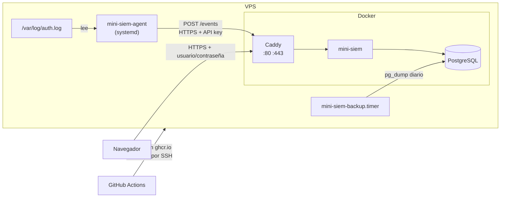

# Despliegue en un VPS

Guía para poner el SIEM en línea con HTTPS y el agente vigilando el SSH del propio servidor. Probado para Debian 12+ y Ubuntu 24.04+ en `amd64`.



| Pieza | Qué hace |
|---|---|
| [`compose.yml`](compose.yml) | Caddy + app + PostgreSQL. Solo Caddy publica puertos (80 y 443) |
| [`Caddyfile`](Caddyfile) | Certificado de Let's Encrypt, cabeceras de seguridad y usuario/contraseña para todo salvo `POST /events` y `/healthz` |
| [`setup-vps.sh`](setup-vps.sh) | Preparación inicial (una vez, como root): paquetes, Docker, usuario `deploy`, firewall, unidades de systemd |
| [`deploy.sh`](deploy.sh) | Lo ejecuta GitHub Actions: descarga la imagen nueva, la levanta, espera a que esté sana y, si no lo está, vuelve a la anterior |
| [`backup.sh`](backup.sh) | `pg_dump` comprimido, guarda 14 días |
| [`systemd/`](systemd/) | El agente (sin privilegios, endurecido) y el temporizador de copias |

## 1. Crear el VPS y el subdominio

1. Crea un VPS con Debian 12 o Ubuntu 24.04 (1 GB de RAM alcanza) y entra con tu clave SSH como root.
2. En tu proveedor de DNS, crea un registro `A` (y `AAAA` si el VPS tiene IPv6) para el subdominio, por ejemplo `siem.tudominio.com`, apuntando a la IP del VPS. Caddy no puede pedir el certificado hasta que el DNS resuelva.

## 2. Preparar el servidor

Desde tu máquina, en la raíz del repo:

```bash
scp -r deploy root@IP_DEL_VPS:/root/mini-siem-deploy
ssh root@IP_DEL_VPS bash /root/mini-siem-deploy/setup-vps.sh
```

El script instala Docker, `ufw` y `rsyslog` (las imágenes recientes de Debian no crean `auth.log` sin él), crea el usuario `deploy`, deja los archivos en `/opt/mini-siem`, instala las unidades de systemd, activa las copias diarias y abre solo los puertos 22, 80 y 443. Se puede repetir sin pisar la configuración.

## 3. Endurecer SSH (a mano)

Con una sesión abierta como respaldo (si algo sale mal, te deja entrar), edita `/etc/ssh/sshd_config.d/10-hardening.conf`:

```
PasswordAuthentication no
KbdInteractiveAuthentication no
PermitRootLogin prohibit-password
```

Comprueba y recarga: `sshd -t && systemctl reload ssh`. Abre **otra** terminal y verifica que sigues entrando antes de cerrar la primera.

Con contraseñas desactivadas, los bots ya no pueden adivinar nada, pero lo siguen intentando: el agente cuenta cada conexión que se va sin autenticarse, así que el SIEM sigue viendo los ataques.

## 4. Configurar los secretos

En el VPS, como root:

```bash
openssl rand -hex 24   # -> POSTGRES_PASSWORD
openssl rand -hex 32   # -> INGEST_API_KEY (va en los dos archivos)
docker run --rm caddy:2-alpine caddy hash-password --plaintext 'una-contraseña-larga'   # -> PANEL_PASSWORD_HASH

nano /opt/mini-siem/.env            # SIEM_DOMAIN, POSTGRES_PASSWORD, INGEST_API_KEY, PANEL_*, Telegram
nano /etc/mini-siem/agent.env       # SIEM_URL=https://siem.tudominio.com e INGEST_API_KEY
```

`PANEL_PASSWORD_HASH` va entre comillas simples: el hash tiene `$` y, sin ellas, Docker Compose los trata como variables.

`POSTGRES_PASSWORD` solo se aplica la primera vez que arranca Postgres (cuando crea el volumen). Cambiarla después en `.env` no cambia la de la base.

## 5. Conectar GitHub Actions

1. Genera una clave solo para desplegar (en tu máquina): `ssh-keygen -t ed25519 -f deploy_key -N "" -C github-deploy`.
2. Copia `deploy_key.pub` a `/home/deploy/.ssh/authorized_keys` en el VPS.
3. Obtén la huella del servidor: `ssh-keyscan IP_DEL_VPS`.
4. En GitHub, *Settings → Secrets and variables → Actions*:

| Tipo | Nombre | Valor |
|---|---|---|
| Variable | `DEPLOY_HOST` | IP o nombre del VPS |
| Variable | `SIEM_DOMAIN` | `siem.tudominio.com` |
| Secreto | `DEPLOY_SSH_KEY` | Contenido de `deploy_key` (la privada) |
| Secreto | `DEPLOY_KNOWN_HOSTS` | Salida de `ssh-keyscan` |

5. Lanza el workflow **Deploy** a mano (*Actions → Deploy → Run workflow*) o haz push a `main`. A partir de ahí, cada commit que pasa el CI se despliega solo.

El workflow publica la imagen en `ghcr.io/williamfloress/mini-siem` con dos etiquetas (el SHA del commit y `latest`), compila el agente, copia los archivos de `deploy/` y ejecuta `deploy.sh <sha>`. Al final comprueba `https://SIEM_DOMAIN/healthz` desde fuera.

Para exigir aprobación antes de cada despliegue, añade revisores al environment `production` (*Settings → Environments*).

## 6. Activar el agente

Tras el primer despliegue, el binario ya está en `/opt/mini-siem/bin/mini-siem-agent`:

```bash
systemctl enable --now mini-siem-agent
journalctl -u mini-siem-agent -f
```

Los despliegues siguientes actualizan el binario y reinician el servicio solos (el usuario `deploy` tiene permiso de `sudo` solo para ese comando).

El agente corre con un usuario temporal sin privilegios (`DynamicUser`) que solo pertenece al grupo `adm`, el que puede leer `auth.log`. No puede escribir en el disco ni cargar módulos, y solo puede abrir sockets de red.

## 7. Probar

Desde **otra** máquina (si lo haces desde tu IP, el SIEM la marcará como atacante, que es justo lo que quieres ver):

```bash
for i in 1 2 3 4 5 6; do ssh -o BatchMode=yes -o ConnectTimeout=5 usuario-falso@siem.tudominio.com true; done
```

Cada intento es un `login_failed`. Al quinto llega la alerta `brute_force` a Telegram y aparece en `https://siem.tudominio.com/`. En unas horas, los bots de internet harán lo mismo sin que tengas que provocarlo.

Sin otra máquina, con `curl` y la API key desde cualquier sitio:

```bash
KEY="tu-api-key"
for i in 1 2 3 4 5; do
  curl -s -X POST https://siem.tudominio.com/events -H "Authorization: Bearer $KEY" \
    -d "{\"timestamp\":\"$(date -u +%FT%TZ)\",\"source\":\"ssh\",\"type\":\"login_failed\",\"ip\":\"203.0.113.7\",\"user\":\"root\"}"
done
```

## Operación

| Tarea | Comando (en `/opt/mini-siem`, como `deploy`) |
|---|---|
| Estado | `docker compose ps` |
| Logs del SIEM | `docker compose logs -f app` |
| Logs del agente | `journalctl -u mini-siem-agent -f` (como root) |
| Volver a una versión anterior | `./deploy.sh <sha>` o relanzar el workflow sobre ese commit |
| Copia manual | `./backup.sh` |
| Restaurar una copia | `docker compose stop app`, luego `gunzip -c /var/backups/mini-siem/siem-FECHA.sql.gz \| docker compose exec -T postgres psql -U siem -d siem` y `docker compose start app` |
| Próxima copia programada | `systemctl list-timers mini-siem-backup.timer` |

## Decisiones y límites

- **Caddy en vez de nginx + certbot.** Pide y renueva el certificado solo, y la configuración entera cabe en 30 líneas.
- **Usuario y contraseña en el proxy, no en la app.** El panel y los `GET` muestran datos de los eventos; protegerlos en Caddy no toca el código del SIEM. `POST /events` queda fuera porque ya tiene su API key, y `/healthz` porque un monitor externo debe poder consultarlo.
- **Postgres y la app no publican puertos.** Docker se salta `ufw` al publicar un puerto, así que lo único que llega desde internet es lo que Caddy deja pasar.
- **Imagen etiquetada con el SHA.** Cada despliegue es una imagen exacta y volver atrás es desplegar el SHA anterior. `deploy.sh` solo guarda el tag nuevo en `.env` cuando la versión nueva pasa el healthcheck.
- **El grupo `docker` equivale a root.** La clave de despliegue de GitHub Actions es tan sensible como la de root: guárdala solo como secreto del repo.
- **Las copias están en el mismo VPS.** Sirven ante un error (un `DELETE` de más, una migración rota), no ante perder el servidor. Para eso, cópialas fuera (`rclone`, `scp`) o activa los snapshots del proveedor.
- **El agente empieza por las líneas nuevas.** Si está parado un rato, lo que se escribió mientras tanto no se envía (no guarda la posición del archivo).
- **Solo `amd64`.** Para un VPS ARM habría que compilar la imagen y el agente para `arm64`.
